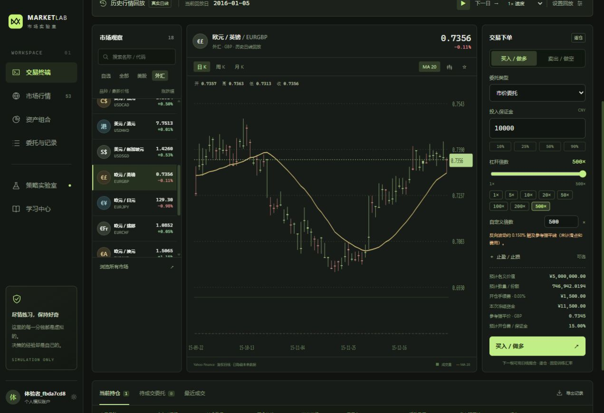

# Market Lab · 市场实验室

深色、多资产、本地账户的模拟交易网站。用 **2006—2025 的真实历史日线**练习交易，支持暂停、逐日推进、加速回放，也可切换合成行情进行压力测试。

**全部资金与交易均为虚拟。** 历史行情来自 Yahoo Finance；普通基金为明确标记的合成示例。它是一套完整可运行的本地练习系统，不是券商交易系统，也没有连接真实账户。



## 53 个品种 / 两种模式

| 市场 | 内置品种 | 数据与训练杠杆 |
|---|---|---|
| A 股 | 贵州茅台、招商银行、宁德时代 | 真实历史；1–20 倍 |
| 港股 | 腾讯、阿里巴巴 | 真实历史；1–20 倍 |
| 美股 | 苹果、微软、英伟达、特斯拉、亚马逊、谷歌 | 真实历史；1–20 倍 |
| ETF | SPY、QQQ、TLT、沪深 300 ETF、创业板 ETF、IWM 小盘股、DIA 道指、VTI 全市场、EEM 新兴市场、VNQ 房地产、LQD 公司债 | 真实历史；1–10 倍 |
| 外汇 | EURUSD、GBPUSD、USDJPY、USDCNY、AUDUSD、NZDUSD、USDCHF、USDCAD、USDHKD、USDSGD、EURGBP、EURJPY、EURCHF、EURAUD、GBPJPY、GBPCHF、AUDJPY、CADJPY（18 对） | 真实历史；1–500 倍 |
| 加密资产 | BTC、ETH | 真实历史；1–100 倍 |
| 商品代理 | GLD 黄金 ETF、SLV 白银 ETF、USO 原油基金 | 真实历史；1–50 倍 |
| 指数 | 标普 500、恒生、纳斯达克 100、道琼斯工业指数、日经 225 | 真实历史；虚拟合约 1–100 倍 |
| 普通基金 | 指数、债券、科技三只模拟基金 | 仅合成；1 倍、仅做多、每 20 步净值结算 |

历史品种共 50 个。数据长度随上市时间变化：苹果等覆盖 2006–2025，BTC 从 2014 年开始，ETH 从 2017 年开始，宁德时代从 2018 年开始，阿里港股从 2019 年开始。网站「学习中心」显示逐个品种的来源、日期和条数。

## 本次扩展（v1.1）

- 外汇从 4 对增至 18 对，增加欧元/英镑、欧元/日元、欧元/瑞郎、欧元/澳元等交叉盘。
- 外汇最高 500×，股票 20×、ETF 10×、加密资产与指数 100×、商品 50×，普通模拟基金保持 1×。这些属于本软件的模拟设置。
- 下单支持常用杠杆按钮、滑块与整数输入，显示参考强平价、反向波动幅度及开仓手续费占保证金比例。
- 示例：500× 新仓在价格反向变化约 0.15% 时触及参考强平线（未计滑点）；单次开仓手续费等于初始保证金的 15%。
- 原账户自动升级，保留资金、持仓、委托、自选、交易记录和回放进度。首次升级前自动保存 `data/accounts-before-v2-时间戳.sqlite` 数据库备份。
- 从旧版本更新时，**保留原有 data 文件夹**，覆盖源码，停止旧服务后双击 `start.cmd`；启动器会自动补齐新增品种。也可手动运行 `node scripts/download-history.mjs` 后重启。不得用其他账户数据库覆盖本机 `accounts.sqlite`。离线包不含账户数据库。

## 快速开始

需要 **Node.js 24 或更新版本**（[官方下载](https://nodejs.org/)）。不需要 npm install，不需要数据库软件，不需要 API Key。

### Windows

解压后双击 **`start.cmd`**。它会启动本地服务并打开浏览器。

源码版首次启动会下载历史数据，通常需要几十秒；带历史数据的离线版可直接启动。若网络或数据源暂时不可用，仍可使用合成模式，稍后重新运行下载脚本即可。

### macOS / Linux

```sh
sh start.sh
```

### 手动运行（所有系统）

```sh
node scripts/download-history.mjs  # 仅首次需要下载；离线完整版可跳过
node server.mjs
```

在浏览器打开 **http://127.0.0.1:4311**。创建用户名和密码（至少 8 位），默认获得 **100 万人民币虚拟资金**。也可点击「进入演示账户」试用，无默认共享密码。

启动窗口需要保持运行，按 `Ctrl+C` 停止。重启后保留已存账户、持仓、委托与历史回放进度。退出或关闭浏览器不会立即销毁注册账户；服务器仍运行且回放未暂停时，回放会继续。临时演示账户只适合试用，退出后不能通过密码找回。

端口被占用时，PowerShell 中可指定：

```powershell
$env:PORT = '4312'
node server.mjs
```

然后访问 `http://127.0.0.1:4312`。启动器发现已有 Market Lab 服务时会复用该服务。

## 第一次练习

1. 创建本地账户，或进入演示账户。
2. 默认回到 **2016-01-04**，回放暂停。选择苹果、SPY 等当日可交易品种。
3. 输入保证金，选择杠杆、做多 / 做空及委托类型，可选止盈止损。
4. 点击买入 / 做空。历史模式会先冻结保证金与开仓费。
5. 点击「下一日」或播放。市价委托在下一根可用日线开盘成交；限价与止损单等待价格触发。
6. 在当前持仓设置保护条件或平仓。历史平仓也等待下一根可用日线开盘。
7. 到「资产组合」检查权益、胜率、回撤与资金流水；到「委托与记录」导出 CSV 或 JSON 训练存档。
8. 「策略实验室」可加载 2008、2020、2022 场景或自定义起点。新训练会重置当前账户训练数据，界面会要求确认，并提供先导出记录的入口。

回放速度 1× / 2× / 5× / 10× 分别表示每 3 秒推进 1 / 2 / 5 / 10 个日期；历史日期取所有品种交易日期的并集，包含加密资产周末。无该日行情的品种不可新开仓，已有委托等待下一个可用交易日。

## 已实现

- 本地注册、登录、退出、独立账户、持久化 SQLite 数据库。
- 多市场搜索、自选列表、日 / 周 / 月 K 线、线图切换、MA20、成交量与 OHLC 查看。
- 历史未来数据隐藏，逐日 / 自动加速回放，历史场景选择。
- 市价、限价、止损触发开仓；做多做空；按品种设置杠杆上限。
- 逐仓保证金、手续费、滑点、止盈、止损、强平、撤单退款。
- 基金合成净值申购 / 赎回，合成市场 ±5% / ±10% 压力测试。
- 虚拟充值、账户重置、持仓统计、权益曲线、平仓胜率、回撤、资金流水。
- 完整交易 CSV、JSON 训练存档导出；桌面与窄屏响应式界面。
- 无第三方运行依赖、无 CDN、无遥测。行情下载后可离线使用。

## 模型说明：真实行情与简化交易规则

本项目整合常见训练功能，**并未复制所有市场的真实交易制度**。

- 所有品种统一使用按人民币计价的虚拟保证金合约。A 股也允许模拟做空、杠杆和当日平仓，这些都是训练规则；未实现 T+1、整手限制、涨跌停、借券限制。
- 商品通过 GLD / SLV / USO 基金代理，指数为虚拟合约；没有实物交割、到期换月、期权或真实订单簿。
- `OHLC × adjustedClose / close` 得到复权行情，包含拆股和分红调整；不重复派息。复权价格不等于当日实际报价。
- 历史市价单在下一根可用日线开盘成交；限价单按 high/low 触发并考虑有利跳空；止损开仓单按 high/low 触发并考虑不利跳空。限价成交价不会比限价更差。
- 日线无法确定盘中路径。同一根 K 线按 **强平 → 止损 → 止盈** 的保守顺序处理，包括新开仓使用整根日线范围。这可能比真实盘中路径更悲观。
- 单边手续费 **0.03%**，开平仓滑点 **0.015%**。名义金额 = 保证金 × 杠杆，实际份额根据成交价重新计算。挂单冻结保证金和预计开仓费，撤单全额退款。
- 新仓维持保证金率为 **min(0.5%, 25% ÷ 杠杆)**，阈值 = 开仓名义价值 × 该比率。高杠杆下阈值不超过初始保证金的 25%。原版本已有持仓和未成交委托保留原来的 0.5% 规则，不更改其强平价。强平价未计未来平仓费。逐仓损失以该笔保证金为限，开仓费另计；跳空超额损失按模拟保护规则豁免。
- 固定训练换算率：USD→CNY 7.2；HKD→CNY 0.92；JPY→CNY 0.048；CNY 1；GBP 9.1、CHF 8、CAD 5.3、SGD 5.4、AUD 4.75。**不是回放当日汇率**。不计算融资利息、隔夜费、税费和真实汇率敞口。
- 普通基金仅合成模式可用，每 20 步净值结算，不代表实际基金净值或真实申赎周期。
- 净收益剔除充值，已实现盈亏包含该仓开平仓费用。权益曲线按采样步骤统计，回撤剔除充值并以 100 万基准归一；不会捕获日内未采样权益低点。页面成交和委托各展示最近 500 条，导出包含完整数据。
- 图表只显示回放时点以前最近 240 根日线，并聚合为周/月 K。跨市场时区按数据源日期近似对齐，不用于严谨的跨市场时序套利研究。
- 历史数据完整性依赖上游；下载失败的品种不伪造历史。数据下载器可重试，默认重用本地缓存。

## 历史数据与更新

首次下载锁定 **2006-01-01 至 2025-12-31**。每个数据文件包含原始下载 URL、抓取时间、调整方式及真实覆盖区间。

数据校验会剔除最高/最低价未包含开收盘价的异常 OHLC，保留 `excludedRows` 日期与原因。不会补造价格。交付时共有 **236,806 根有效日线**，排除了 **2,689 根不一致日线**；它们按缺失交易日处理。各品种排除数量显示在学习中心及 manifest.json。

```sh
node scripts/download-history.mjs            # 下载缺失数据
node scripts/download-history.mjs --refresh  # 重新获取固定区间
```

下载完成后重启服务器以载入新数据。网站「学习中心」可核对逐个品种来源。

**源码授权与历史数据授权分开。** 代码采用 MIT；Yahoo Finance 数据不在 MIT 授权范围内，使用和传播需遵循数据提供方条款。`data/` 已被 Git 忽略。推荐向 GitHub 上传「源码包」，让每个使用者在本机下载历史数据；「离线完整包」用于本地练习，不要把其中的 `data/` 直接放进公开仓库。

## 上传 GitHub

**推荐：解压 `market-lab-source-v1.1.zip`，将其中 `market-lab` 文件夹内的源码上传到仓库。**

或者在项目目录执行（仓库地址替换为你的）：

```sh
git init
git add .
git commit -m "Initial Market Lab simulator"
git branch -M main
git remote add origin https://github.com/YOUR_NAME/market-lab.git
git push -u origin main
```

`.gitignore` 已排除 `data/`，包括历史缓存、账户数据库、密码散列与登录会话。若用 GitHub 网页上传，请上传源码 ZIP 解压后的文件，不要上传离线包内的 `data/`。

**GitHub 仓库可以保存源码；GitHub Pages 只托管静态文件，不能直接运行本项目的 Node.js 登录服务。** 本地运行使用上述启动方式。如果以后要公网部署，需要另行部署服务、HTTPS、备份和访问控制；当前服务器刻意只监听 `127.0.0.1`。

## 本地数据、备份与开发

```text
market-lab/
├─ public/                   # 中文界面、样式、图表和浏览器交互
├─ lib/catalog.mjs           # 53 个品种、固定训练汇率、费率
├─ lib/engine.mjs            # 保证金、订单、回放、强平、资金核算
├─ server.mjs                # HTTP API、账户认证、SQLite、回放时钟
├─ scripts/download-history.mjs
├─ scripts/start.mjs
├─ tests/                    # 交易引擎和 HTTP 流程测试
├─ data/history/             # 下载的行情及 manifest.json（Git 忽略）
├─ data/accounts.sqlite      # 注册用户与账户状态（Git 忽略）
├─ start.cmd                 # Windows 一键启动
└─ start.sh                  # macOS / Linux 启动
```

密码使用独立盐值和 scrypt 散列，登录令牌只在数据库保存 SHA-256 摘要。会话 Cookie 使用 HttpOnly 与 SameSite=Strict，接口检查本机 Host、Origin 和自定义请求头。没有默认密码、云端账号或找回密码邮件功能。

要备份完整账户，请**先停止服务器，再复制整个 `data/` 文件夹**；不要只复制运行中的 SQLite 主文件。网页 JSON 导出用于交易记录归档与分析，不包含密码，不提供自动导入恢复。恢复完整账户时，停止服务并还原之前保存的 `data/` 文件夹。

```sh
node --test tests/*.test.mjs
```

测试涵盖资金守恒、冻结和退款、避免未来数据、下一日撮合、跳空、限价/止损、强平损失上限、净值周期、非交易日、账户隔离、登录持久化和 CSRF 检查。

参考：[TradingView 模拟交易功能](https://www.tradingview.com/support/solutions/43000516466-paper-trading-main-functionality/)、[Investor.gov 基金与 ETF 说明](https://www.investor.gov/introduction-investing/general-resources/news-alerts/alerts-bulletins/characteristics-mutual-funds-exchange-traded-funds)。
